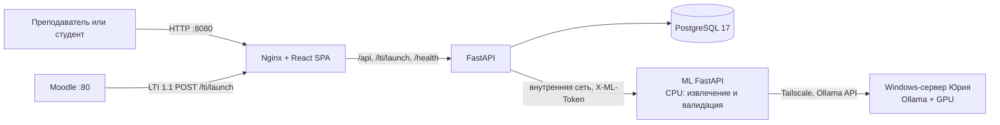

# Лаб.АИ — ассистент проверки лабораторных работ

Лаб.АИ — учебный MVP для предварительной проверки лабораторных работ с помощью локальной LLM. Преподаватель задаёт материалы и критерии, студент загружает PDF или DOCX, а система формирует проверяемую обратную связь и, при наличии числовой рубрики, предварительную оценку.

Проект интегрируется с Moodle через LTI 1.1. Основное приложение запускается одной командой: React/Nginx, FastAPI и PostgreSQL работают в Docker, а ресурсоёмкий inference выполняет Ollama на отдельном Windows-сервере с GPU.

> Это демонстрационный MVP. Итоговое решение о работе принимает преподаватель. Отправка оценок обратно в журнал Moodle через Outcomes пока не реализована.

## Единый запуск через Docker

### Что потребуется

- Git;
- Docker Desktop с включённым режимом Linux containers;
- Docker Compose v2 (`docker compose version`);
- доступ по Tailscale к Windows-серверу с Ollama — адрес и доступ выдаёт Юрий;
- свободный порт `8080` на компьютере.

Локальные Node.js, Python, PostgreSQL, Ollama, Make и GPU для основного запуска не нужны.

### Быстрый старт

```powershell
git clone https://github.com/acuraels/moodle-lab-assessment-assistant.git
cd moodle-lab-assessment-assistant
Copy-Item .env.example .env
```

Откройте `.env` и обязательно задайте:

- `POSTGRES_PASSWORD` и согласованный с ним `DATABASE_URL`;
- случайный длинный `JWT_SECRET`;
- одинаковые для приложения и Moodle `LTI_CONSUMER_KEY` и `LTI_CONSUMER_SECRET`;
- `ML_TOKEN` — общий секрет backend и ML-сервиса;
- `OLLAMA_URL=http://<TAILSCALE_IP_СЕРВЕРА_ЮРИЯ>:11434`;
- `OLLAMA_MODEL=freehuntx/qwen3-coder:14b` — модель, на которой проводились измерения проекта.

Не используйте примерные значения секретов в общей или публичной среде и не добавляйте `.env` в Git.

Для первой установки создайте внешний volume PostgreSQL один раз:

```powershell
docker volume create backend_postgres_data
```

Если `backend_postgres_data` уже содержит рабочую БД, повторно создавать его не нужно. Сначала сделайте резервную копию по инструкции ниже.

Проверьте конфигурацию и запустите приложение вместе с ML-сервисом:

```powershell
docker compose --profile ml config --quiet
docker compose --profile ml up --build -d
docker compose --profile ml ps
```

Откройте:

- приложение — <http://localhost:8080/>;
- healthcheck FastAPI через Nginx — <http://localhost:8080/health>.

Проверка доступности выбранной модели из ML-контейнера:

```powershell
docker compose exec -T ml python -c "import os,urllib.request; print(urllib.request.urlopen(os.environ['OLLAMA_URL'].rstrip('/')+'/api/tags', timeout=10).status)"
docker compose exec -T backend python -c "import os,urllib.request; r=urllib.request.Request(os.environ['ML_URL'].rstrip('/')+'/ready', headers={'X-ML-Token':os.environ.get('ML_TOKEN','')}); print(urllib.request.urlopen(r, timeout=10).status)"
```

Ответ `200` от `/ready` подтверждает доступность Ollama и наличие модели, но не заменяет пробную проверку документа.

## Архитектура



В основном `compose.yaml`:

| Сервис | Назначение | Доступ с хоста |
|---|---|---|
| `frontend` | production-сборка React, Nginx, SPA fallback и reverse proxy | `127.0.0.1:8080` |
| `backend` | FastAPI, LTI, JWT, API и обработчик очереди попыток | не публикуется |
| `postgres` | PostgreSQL 17 и постоянное хранение данных | не публикуется |
| `ml` | извлечение PDF/DOCX, подготовка промпта и проверка ответа модели | профиль `ml`, по умолчанию `127.0.0.1:8001` |
| `ollama` | необязательный локальный runtime вместо удалённого сервера | отдельный профиль `ollama` |

Backend использует таблицу попыток как сохраняемую очередь и обрабатывает задания последовательно. Redis и отдельный брокер очередей не требуются. ML-сервис не имеет доступа к БД или JWT: он получает снимок материалов и документ, извлекает текст на CPU и вызывает Ollama. GPU требуется только серверу модели.

## Структура репозитория

| Путь | Содержимое |
|---|---|
| `apps/frontend/` | React 19, TypeScript, Vite 8, Nginx |
| `apps/backend/` | FastAPI, SQLAlchemy, Alembic, LTI 1.1 |
| `apps/ml/` | обработка документов и клиент Ollama |
| `packages/assessment-contract/` | общие схемы backend и ML |
| `compose.yaml` | единая Docker-инфраструктура |
| `compose.gpu.yaml` | дополнение для локального NVIDIA Ollama |
| `api.md` | актуальный контракт HTTP API |
| `docs/` | эксплуатационная документация и отчёты |

## Переменные окружения

### Приложение и база данных

| Переменная | Назначение | Типичное значение |
|---|---|---|
| `FRONTEND_PORT` | порт Nginx на хосте | `8080` |
| `FRONTEND_URL` | внешний адрес для LTI redirect | `http://localhost:8080/` |
| `VITE_ENABLE_TEST_LOGIN` | показать форму входа по настоящему JWT | `true` только для тестирования |
| `POSTGRES_VOLUME_NAME` | существующий внешний volume | `backend_postgres_data` |
| `POSTGRES_DB` | имя БД | `lab_assessment` |
| `POSTGRES_USER` | пользователь БД | `postgres` |
| `POSTGRES_PASSWORD` | пароль БД | секрет |
| `DATABASE_URL` | URL внутри Docker-сети | `postgresql+asyncpg://postgres:<URL_ENCODED_PASSWORD>@postgres:5432/lab_assessment` |
| `JWT_SECRET` | подпись пользовательских JWT | секрет |
| `LTI_CONSUMER_KEY` | ключ LTI 1.1 | совпадает с Moodle |
| `LTI_CONSUMER_SECRET` | секрет LTI 1.1 | совпадает с Moodle |
| `MAX_FILE_SIZE_BYTES` | лимит загружаемого файла | `20971520` (20 МиБ) |

Специальные символы в логине и пароле внутри `DATABASE_URL` должны быть URL-кодированы. Изменение `POSTGRES_PASSWORD` не меняет пароль в уже созданной БД.

### ML и модель

| Переменная | Назначение | Рекомендуемое значение |
|---|---|---|
| `ML_URL` | адрес ML-сервиса для backend | `http://ml:8001` |
| `ML_TOKEN` | общий секрет backend → ML | случайная длинная строка |
| `ML_TIMEOUT_SECONDS` | ожидание полной оценки | `540` |
| `ML_MAX_ATTEMPTS` | число попыток при временной ошибке | `2` |
| `OLLAMA_URL` | Ollama на Windows через Tailscale | получить у Юрия |
| `OLLAMA_MODEL` | точное имя загруженной модели | `freehuntx/qwen3-coder:14b` |
| `ML_CONTEXT_TOKENS` | контекст модели | `8192` |
| `ML_MODEL_TIMEOUT_SECONDS` | таймаут одного вызова модели | `180` |
| `ML_TOKENIZER_PATH` | необязательный путь к совместимому токенизатору | пусто, если не настроен |

В `.env.example` может оставаться более лёгкая модель-кандидат `qwen3:4b-instruct-2507-q4_K_M`. Она не является моделью, на которой подтверждены текущие метрики. Для воспроизведения результатов явно задайте `freehuntx/qwen3-coder:14b`.

## Сервер модели Ollama

Текущая рекомендуемая схема — Ollama, запущенная нативно на отдельном Windows-компьютере с GPU. Перед запуском получите у Юрия Tailscale IPv4 сервера и подтверждение, что нужная модель установлена. Публично открывать порт `11434` в интернет нельзя.

Владелец GPU-сервера запускает Ollama в PowerShell:

```powershell
$env:OLLAMA_HOST = '<TAILSCALE_IP_СЕРВЕРА>:11434'
$env:OLLAMA_NO_CLOUD = '1'
$env:OLLAMA_NUM_PARALLEL = '1'
$env:OLLAMA_MAX_LOADED_MODELS = '1'
$env:OLLAMA_CONTEXT_LENGTH = '8192'
ollama serve
```

Перед этим нужно полностью закрыть Ollama из системного трея, иначе второй процесс не сможет занять порт. В другом терминале владельца сервера:

```powershell
$env:OLLAMA_HOST = '<TAILSCALE_IP_СЕРВЕРА>:11434'
ollama --version
ollama list
```

Загрузка весов выполняется владельцем сервера только при осознанной необходимости:

```powershell
ollama pull freehuntx/qwen3-coder:14b
```

В измерении от 8 ноября 2026 года использовались Ollama `0.19.0`, контекст `8192`, модель `freehuntx/qwen3-coder:14b` (14,8 млрд параметров, Q4_K_M). Ollama сообщала около 10,05 ГиБ VRAM для модели. Это историческая конфигурация измерения, а не гарантия текущей версии или запущенного процесса — актуальное состояние уточняйте у Юрия.

Подробнее: [развёртывание ML](docs/ml-deployment.md), [методика и результаты](docs/ml-grading-evaluation.md), [PDF-отчёт](docs/reports/ml-grading-evaluation-2026-11-08.pdf).

## PostgreSQL, миграции и резервные копии

Compose использует внешний volume `backend_postgres_data`. Внешний volume выбран намеренно: Compose не создаёт незаметно пустую замену существующей БД. Backend ждёт healthcheck PostgreSQL, выполняет `alembic upgrade head` и только затем запускает FastAPI.

Перед первым переходом со старого Compose или изменением инфраструктуры сделайте backup:

```powershell
New-Item -ItemType Directory -Force backups | Out-Null
docker compose exec -T postgres pg_dump -U postgres -d lab_assessment -Fc -f /tmp/lab-assessment.dump
docker compose exec -T postgres pg_restore --list /tmp/lab-assessment.dump
docker compose cp postgres:/tmp/lab-assessment.dump ./backups/lab-assessment.dump
Get-Item ./backups/lab-assessment.dump
```

Подставьте фактические пользователя и БД. Не передавайте бинарный dump через текстовый PowerShell pipeline. Храните копию вне Docker и периодически проверяйте восстановление в отдельной тестовой БД.

Безопасный переход:

1. Узнайте точное имя и mount текущего volume.
2. Создайте и проверьте backup.
3. Перенесите фактические параметры в корневой `.env`.
4. Остановите старый стек без `-v`.
5. Не запускайте два PostgreSQL с одним volume одновременно.
6. Запустите новый стек и проверьте миграции, количество записей и скачивание прежних файлов.

Никогда не используйте `docker compose down -v` для рабочей БД и не запускайте `seed_demo.py` поверх существующих данных.

## Отдельный Moodle для локальной проверки

Moodle живёт в соседнем репозитории и не входит в основной Compose:

```powershell
cd ..
git clone https://github.com/Ulyanayou/moodle-docker.git
cd moodle-docker
```

Отредактируйте находящийся там `.env`: задайте собственные пароли тестовых пользователей и администратора. Не копируйте корневой `.env` приложения и не публикуйте пароли. В свежем клоне Compose также требует вспомогательный файл JupyterHub даже при запуске только Moodle; сам JupyterHub запускать не нужно:

```powershell
New-Item -ItemType Directory -Force jupyterhub/secrets | Out-Null
if (-not (Test-Path jupyterhub/secrets/postgres.env)) {
  Set-Content -Encoding ascii -Path jupyterhub/secrets/postgres.env -Value ("POSTGRES_PASSWORD=" + [guid]::NewGuid().ToString("N"))
}

docker network inspect jupyterhub-network *> $null
if ($LASTEXITCODE -ne 0) { docker network create jupyterhub-network }

docker volume create moodle-db-data
docker volume create moodle-main-data
docker volume create moodle-other-data
docker compose config --quiet mariadb moodle moodle-init
docker compose up -d mariadb moodle moodle-init
docker compose ps -a
docker compose logs --tail 100 moodle moodle-init
```

Откройте <http://localhost/>. Контейнер `moodle-init` должен завершиться с кодом `0`: это одноразовая инициализация, а не постоянно работающий сервис. Он создаёт или обновляет тестовый курс, пользователей, LTI-инструмент и лабораторную.

Не запускайте в этом репозитории `make up`: он поднимает лишние сервисы JupyterHub, один из которых конфликтует с портом `8080`. Не используйте команды очистки volumes.

### Настройка LTI 1.1

В Moodle откройте настройки внешнего инструмента и проверьте:

| Поле | Значение |
|---|---|
| Launch URL | `http://localhost:8080/lti/launch` |
| LTI version | LTI 1.1 |
| Consumer key | значение `LTI_CONSUMER_KEY` основного `.env` |
| Shared secret | значение `LTI_CONSUMER_SECRET` основного `.env` |
| Передача имени и email | включена |
| Передача оценок | выключена |

Скрипт `moodle-init` использует фиксированные тестовые значения ключа и секрета и при повторном запуске снова записывает их в инструмент. После каждого повторного запуска сверяйте настройки Moodle с основным `.env`.

Адрес `localhost` работает, когда Moodle открывают браузером на том же компьютере, где опубликован Nginx. Для запуска с другого устройства потребуется внешний адрес, соответствующие `FRONTEND_URL`, HTTPS и настройки сети; простая замена URL только в Moodle недостаточна.

## Полный пользовательский сценарий

1. Преподаватель открывает созданную LTI-активность в Moodle. Backend проверяет OAuth 1.0, создаёт или находит курс и лабораторную и перенаправляет пользователя в React с короткоживущим JWT.
2. В «Настройках ИИ» преподаватель добавляет методику, критерии, системные инструкции и эталонную работу. Сохранение одной вкладки отправляет полный объект, поэтому прежние материалы не теряются.
3. Для числовой оценки критерии должны содержать явную JSON-рубрику:

```json
{
  "criteria": [
    { "name": "Корректность решения", "max_score": 6 },
    { "name": "Обработка граничных случаев", "max_score": 4 }
  ]
}
```

Обычный текст критериев допустим, но результат будет качественным: `score` и `max_score` останутся `null`. Это не нулевая оценка и не ошибка ML.

4. Студент открывает ту же активность под своей ролью, выбирает PDF или DOCX и отправляет попытку.
5. Backend сохраняет документ и неизменяемый снимок настроек, ML извлекает текст и обращается к удалённой Ollama. OCR и выполнение кода не поддерживаются.
6. Frontend опрашивает статус. Если ожидание в интерфейсе закончилось, обработка в backend продолжается — результат можно обновить позднее.
7. Студент изучает чек-лист и замечания и отправляет результат преподавателю.
8. Преподаватель принимает работу или возвращает её на доработку. Статус `accepted` финальный, повторное решение API отклоняет с `409`.

При исчерпании повторов техническая проблема ML сохраняется как `ai_failed`, а не как оценка `0`. Попытка остаётся в истории. Публикация оценки в журнал Moodle сейчас возвращает `501`, потому что Outcomes не реализован.

Тестовая форма JWT включается `VITE_ENABLE_TEST_LOGIN=true`. Она не генерирует токен и не обходит backend: нужен настоящий JWT с корректной ролью. Без backend можно выбрать Demo Mode — он использует только mock-данные и не является проверкой интеграции.

## Полезные команды

Все команды выполняются из корня основного репозитория:

```powershell
# Состояние и healthchecks
docker compose --profile ml ps

# Последние логи
docker compose --profile ml logs --tail 100 frontend backend postgres ml

# Следить за обработкой попытки
docker compose logs -f backend ml

# Пересобрать после изменения исходников
docker compose --profile ml up --build -d

# Безопасно остановить контейнеры, сохранив данные
docker compose --profile ml down
```

Запуск без ML-профиля поднимает только frontend, backend и PostgreSQL:

```powershell
docker compose up --build -d
```

Такой режим позволяет работать с сохранёнными данными, настройками и решениями преподавателя, но новые автоматические проверки завершатся технической ошибкой, если `ML_URL` недоступен.

Локальный Ollama в Docker — необязательная альтернатива удалённому Windows-серверу:

```powershell
docker compose --profile ml --profile ollama -f compose.yaml -f compose.gpu.yaml up --build -d
```

Она требует совместимого NVIDIA Container Toolkit и отдельно загруженных весов. Для обычной разработки используйте удалённый сервер Юрия.

## Диагностика

| Симптом | Что проверить |
|---|---|
| Compose сообщает, что external volume не найден | Создайте volume только для новой установки; для существующей найдите правильное имя и исправьте `POSTGRES_VOLUME_NAME` |
| Backend не становится healthy | `docker compose logs backend postgres`; корректность `DATABASE_URL`; миграции Alembic; доступность БД |
| Приложение открывается, но проверка получает `ai_failed` | запущен ли профиль `ml`, совпадает ли `ML_TOKEN`, доступны ли `/ready`, Ollama и выбранная модель |
| `/ready` сообщает об отсутствии модели | имя `OLLAMA_MODEL` должно точно совпадать с `ollama list` на сервере |
| Контейнер не видит Tailscale-адрес | доступность tailnet на Windows-хосте, firewall сервера и маршрутизацию Docker Desktop/VPN |
| LTI launch возвращает `401/403` | совпадение key/secret, время на машинах, точный внешний Host/порт/схему и POST launch вместо открытия URL через GET |
| После LTI открывается неверный маршрут | `FRONTEND_URL`, `lab_id` в redirect и доступность SPA fallback Nginx |
| Порт `8080` занят | остановите конфликтующий сервис или согласованно измените `FRONTEND_PORT` и `FRONTEND_URL` |
| `moodle-init` завершился ошибкой | дождитесь установки Moodle, проверьте его логи, пароли в соседнем `.env` и наличие внешних volumes/network |
| PDF обработан без текста | сканированные PDF требуют OCR, которого сейчас нет; загрузите PDF с текстовым слоем |
| Ответ не помещается в контекст | сократите материалы/работу; текущий pipeline намеренно не делает скрытого усечения текста |

Healthcheck backend проверяет FastAPI и `SELECT 1`, но не состояние модели. Healthcheck ML проверяет сам сервис, а `/ready` — соединение с Ollama и наличие точного имени модели. Для полной проверки нужна реальная тестовая попытка.

## Ограничения и подтверждённые результаты

- Есть реальный путь DOCX → очередь PostgreSQL → ML → Ollama → сохранённый результат.
- В отчёте от 8 ноября 2026 года числовая оценка совпала с ожидаемой в 13 из 14 синтетических случаев; отдельно зафиксированы ошибки на SQL-примере и одном реальном DOCX.
- Синтетические тесты не заменяют проверку извлечения документов, а unit-тесты со stub Ollama не доказывают доступность настоящей модели.
- Полный сценарий через конкретный экземпляр Moodle необходимо проверять после настройки LTI; он не считается подтверждённым только по успешным API-тестам.
- Внешний адрес GPU-сервера, текущая версия Ollama, digest модели и автозапуск не хранятся в репозитории — их нужно уточнить у Юрия.

## Документация и проверки

- [HTTP API](api.md)
- [Frontend](apps/frontend/README.md)
- [Backend](apps/backend/README.md)
- [ML-сервис](apps/ml/README.md)
- [Развёртывание ML и Ollama](docs/ml-deployment.md)
- [Оценка качества ML](docs/ml-grading-evaluation.md)

## Команда

| Участник | Направление |
|---|---|
| Даниил Устинов | Frontend и интеграция |
| Ульяна Тришина | Backend |
| Никита Мельников | Machine Learning |
| Рафаэль Шаматов | UI/UX Design |
| Юрий Юшков | Аналитика и инфраструктура модели |

## О проекте

- **Университет:** УрФУ
- **Семестр:** 7
- **Учебный год:** 2026/2027
- **Заказчик:** ООО «Микроэлектроника и Робототехника»
- **Номер проекта:** 436/ЛКП-9538-2026

Проект распространяется на условиях, указанных в [LICENSE](LICENSE).
